<!--
  手順書テンプレート(全ボード共通)
  - このファイルをコピーして、ボードごとのフォルダに保存してから書き始める。
  - 章の番号と名前は変えない。該当しない章は消さずに「本ボードでは作成しない(理由:〜)」と書く。
  - ボード独自の内容は、第9章以降に追加章として書く。
  - このコメントはプレビューには表示されない。消さずに残してよい。
-->

# Raspberry pi Pico 開発手順書

| 項目 | 内容 |
|---|---|
| 対象ボード | Raspberry Pi Pico W / Raspberry Pi Pico 2 W |
| 開発言語 | C / C++（発展：MicroPython） |
| IDE・ツール | Visual Studio Code（v1.x.x）<br>Raspberry Pi Pico 拡張機能（v0.x.x）<br>Tera Term（v5.7.1）<br>Zadig（v2.x ※Pico W のみ） |
| SDK・ライブラリ | Raspberry Pi Pico SDK（v2.x.x）<br>FreeRTOS（v11.x.x） |
| 開発 PC の OS | Windows 11 24H2 |
| 最終検証日 | 2026/11/27 |

## 改版履歴

| 版 | 日付 | 担当者 | 内容 |
|---|---|---|---|
| 0.1 | 2026/11/27 | （担当者名） | 新規作成 |

---

## 0. 概要

### 0.1 この手順書でできること

本手順書は、**Raspberry Pi Pico W** および **Raspberry Pi Pico 2 W** を対象とした、C/C++ 言語による組込み開発の環境構築から実機での動作確認・デバッグまでの一連の手順をまとめたものです。

なお、本手順書内では用語を以下のように統一して記載します。

* **マイコン**: Raspberry Pi Pico W と Raspberry Pi Pico 2 W の両方を指す場合
* **Pico W** / **Pico 2 W**: それぞれのボード単体を指す場合

最後まで進めることで、以下の作業ができるようになります。

* **開発環境の構築**: Visual Studio Code（VS Code）と公式拡張機能を用いた C/C++ ビルド環境のセットアップ
* **プロジェクトの作成とビルド**: 対象マイコン（Pico W / Pico 2 W）に合わせた新規プロジェクトの作成とビルド
* **基本機能の実装（RTOS なし）**: LED 点滅（題材 1）、ボタン入力（題材 2）、UART 出力（題材 3）、タイマ割込み（題材 4）の実装と実機での動作確認
* **マルチタスクの実装（FreeRTOS）**: FreeRTOS の導入・設定、および複数タスク（題材 5）、タスク間通信（題材 6）の実装
* **実機デバッグとログ確認**: Raspberry Pi デバッグプローブを用いた書込み、ブレークポイント・ステップ実行、変数・レジスタ確認、およびシリアルターミナルでの UART ログ確認
* **MicroPython による開発（発展）**: MicroPython 環境の構築と基本題材（題材 1 〜 4）の実装・デバッグ

---

### 0.2 必要な機材

開発および実機検証を進めるにあたり、以下の機材を準備してください。

| 品名 | 数量 | 備考 |
|---|---|---|
| Raspberry Pi Pico W / Pico 2 W | 1 人 1 台 | 開発するボード |
| Raspberry Pi デバッグプローブ | 1 人 1 台 | デバッグ・UART 接続 |
| USB ケーブル（データ通信対応） | 1 人 2 本 | マイコン用(黒)<br>デバッグプローブ用(白) |
| ブレッドボード・ジャンパ線 | 1 人 1 式 | 配線 |
| タクトスイッチ | 1 人 1 個 | 題材 2（ボタン入力） |

> 注意: USB ケーブルは必ずデータ通信対応のものを使用すること。充電専用ケーブルでは PC に認識されない。

---

### 0.3 前提知識・事前準備

本手順書を進めるにあたり、以下の知識および環境が事前に準備されていることを前提とします。未完了の項目がある場合は、先に該当する手順書を参照して準備を整えてください。

#### 0.3.1 前提とする基礎知識

* **Windows の基本操作**: エクスプローラーでのファイル操作、デバイスマネージャーでの COM ポート確認、およびコマンドプロンプトの基本的な操作ができること
* **C/C++ 言語の基礎文法**: 変数、関数、ヘッダファイル（`.h` / `.hpp`）とソースファイル（`.c` / `.cpp`）の基本的な構造を理解していること
* **Pico W / Pico 2 W の基本仕様**: 自身が使用するマイコン（RP2040 搭載の Pico W か、RP2350 搭載の Pico 2 W か）を把握しており、BOOTSEL ボタンや SWD デバッグ端子、GPIO ピン配置の概要を理解していること

#### 0.3.2 事前準備（環境・ツール）

* **開発用 PC の用意**: Windows 11（64 bit）推奨。USB ポートが 2 口以上空きがあること（不足する場合は USB ハブを用意すること）
* **Visual Studio Code（VS Code）のインストール**: 最新版の VS Code が開発用 PC にインストール済みであること

---

## 1. 開発環境構築

本章では、マイコン開発に必要なソフトウェア（シリアルターミナル・VS Code 拡張機能）およびドライバのインストールを行います。

> 注意: Visual Studio Code（VS Code）のインストールは、「0.3 前提知識・事前準備」にて完了していることを前提とする。未完了の場合は先に準備を済ませること。

---

### 1.1 ツールのインストール

#### 1.1.1 Tera Term のインストール

本節では、PC とマイコンをシリアル通信で接続し、データの送受信や確認をするために使用する Tera Term のインストール手順を記載する。  
なお、Tera Term が PC にインストールされていない場合のみ、本節の手順を実施すること。

1. 下記のリンクより、Tera Term 公式 GitHub にアクセスする。  
   [Tera Term 公式 GitHub](https://github.com/TeraTermProject/teraterm/releases)
2. Tera Term 5.7.1 の Assets から **teraterm-5.7.1-x64.exe** をダウンロードする。  
   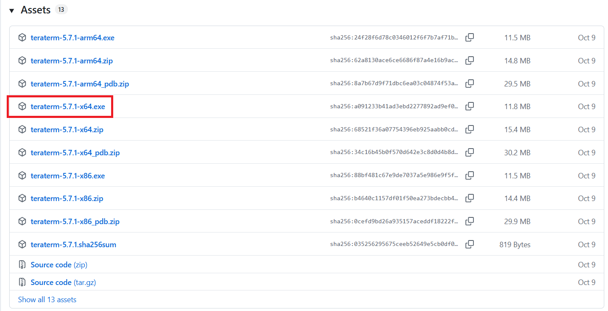
3. ダウンロードした **teraterm-5.7.1-x64.exe** をダブルクリックする。  
   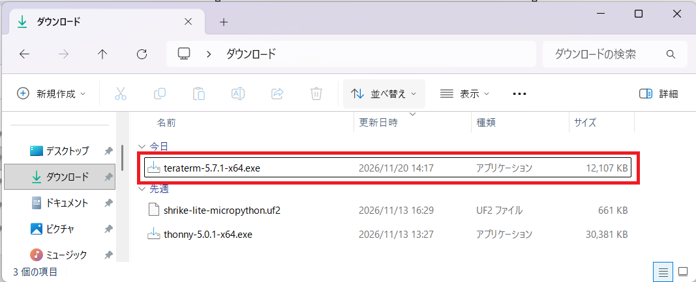
4. 「インストールモードの選択」画面が開いたら、**現在のユーザー用にインストール(M)(推奨)** を選択する。  
   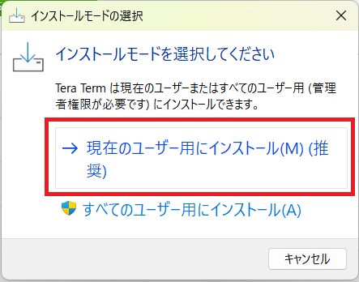
5. 「セットアップに使用する言語の選択」画面が開いたら、インストール中に利用する言語として **日本語** を選択し、「OK」を押下する。  
   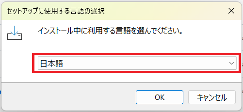
6. 「使用許諾契約書の同意」画面が開いたら、**同意する(A)** を選択する。  
   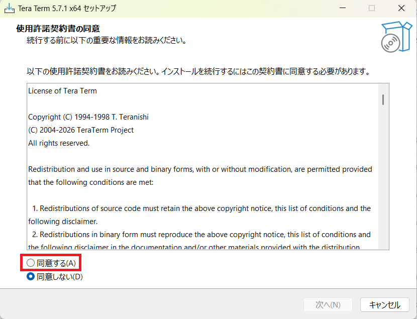
7. **次へ(N)** を押下する。  
   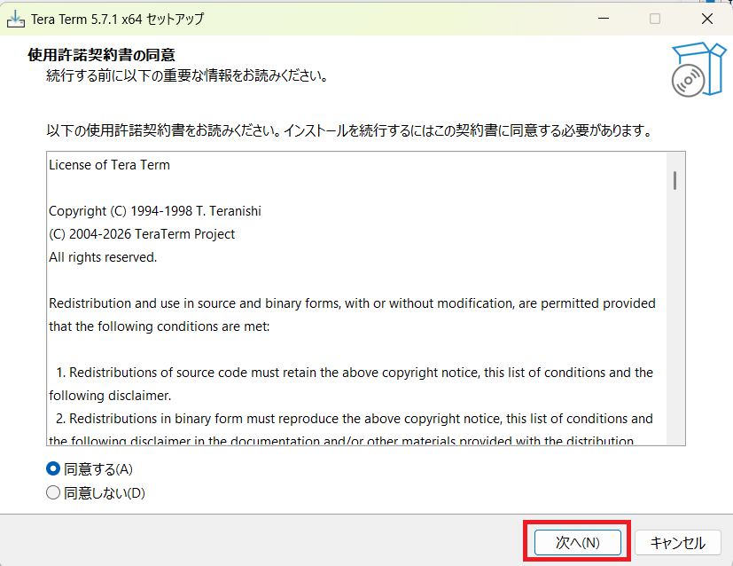
8. 「インストール先の指定」画面が開いたら、**次へ(N)** を押下する。  
   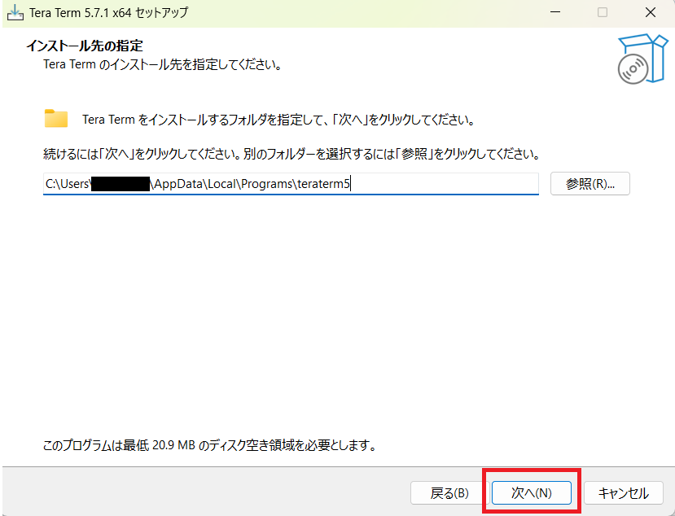
9. 「コンポーネントの選択」画面が開いたら、**次へ(N)** を押下する。  
   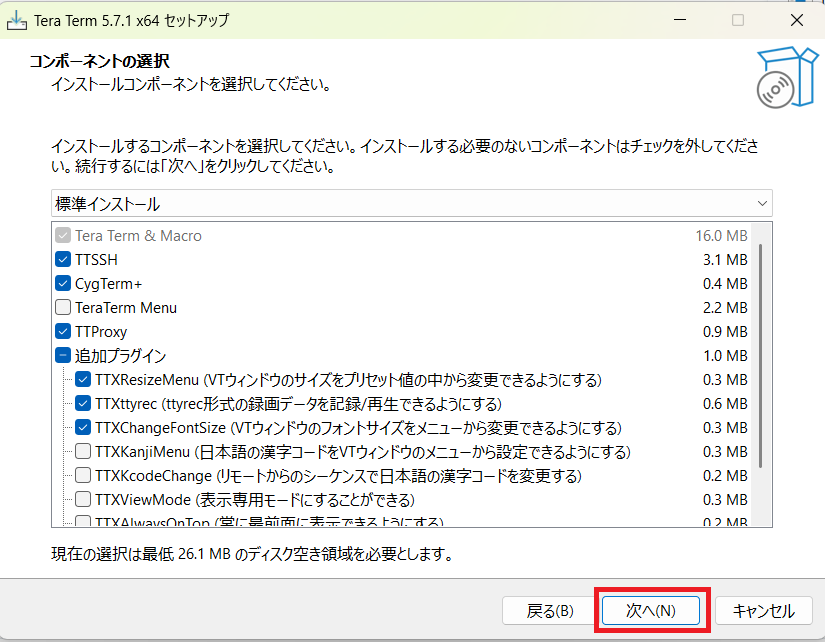
10. 「言語の選択」画面が開いたら、**日本語(J)** を選択し、**次へ(N)** を押下する。  
    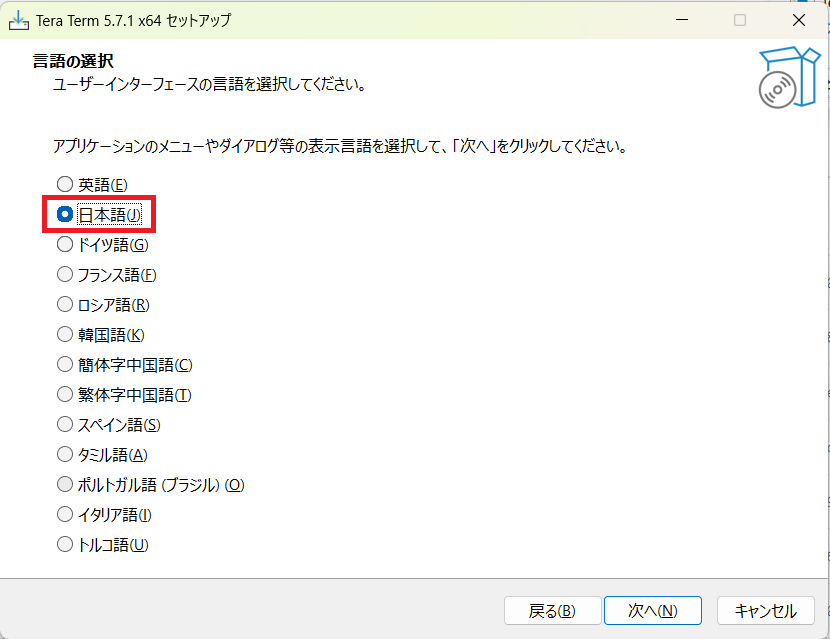
11. 「スタートメニューフォルダーの指定」画面が開いたら、**次へ(N)** を押下する。  
    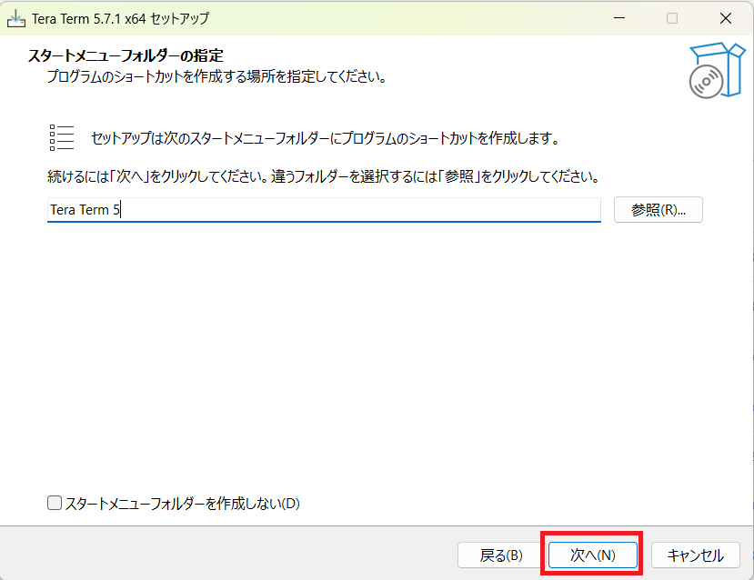
12. 「追加タスクの選択」画面が開いたら、**次へ(N)** を押下する。  
    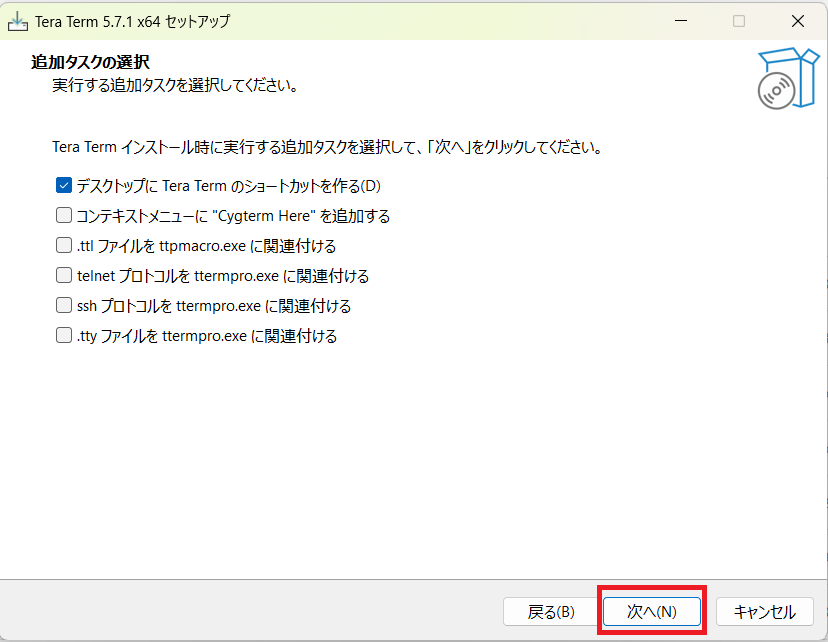
13. 「インストールの準備完了」画面が開いたら、**インストール(I)** を押下する。  
    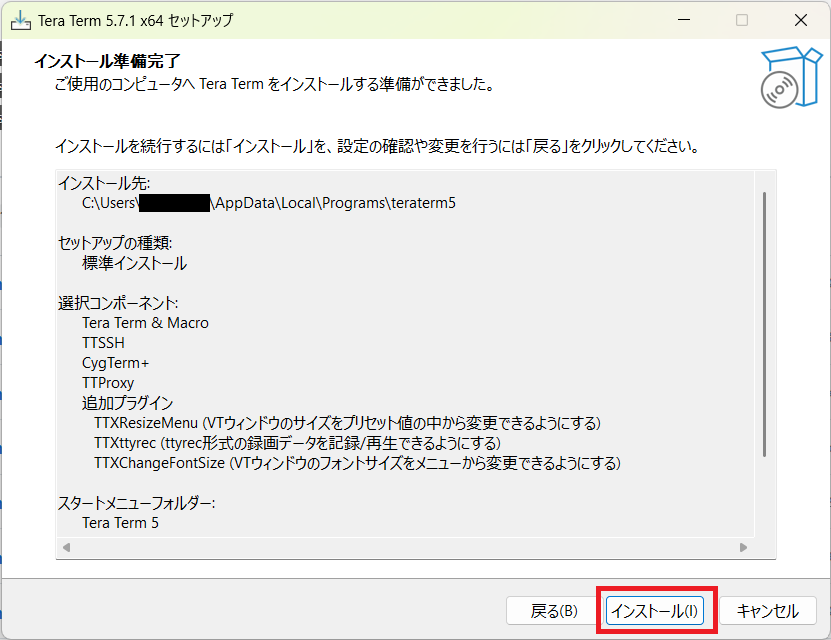

> 確認: 「Tera Term セットアップウィザードの完了」が表示されれば成功。  
> 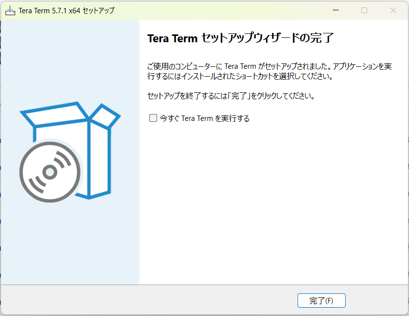

#### 1.1.2 VS Code 拡張機能のインストール

本節では、VS Code 上でマイコンのプロジェクト作成やビルド、デバッグを行うために使用する公式拡張機能 **Raspberry Pi Pico** のインストール手順を記載する。

1. VS Code を起動する。
2. 左側のアクティビティバーにある「拡張機能」アイコンをクリックする。  
   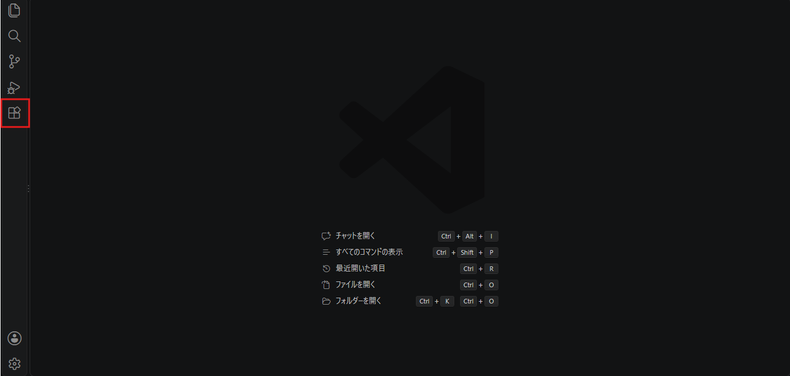
3. 検索ボックスに `Raspberry Pi Pico` と入力する。  
   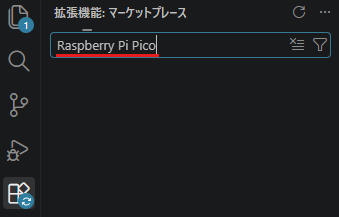  
4. 発行元が **raspberry-pi** となっている **Raspberry Pi Pico** を選択する。  
   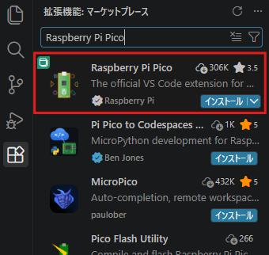  
5. 「インストール」ボタンをクリックする。  
   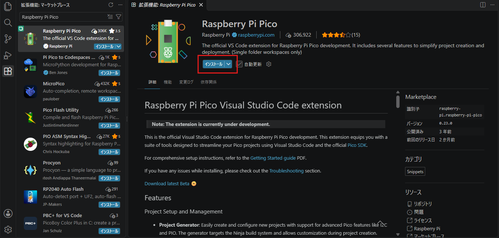

> 確認: インストール完了後、左側のアクティビティバーに Raspberry Pi のアイコンが表示されれば成功。  
> 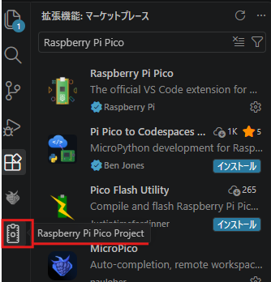

> 注意: 拡張機能のインストール後、必要なツールや SDK の自動ダウンロードがバックグラウンドで実行される場合がある。画面右下の通知が消えるまで待つこと。また、同名の非公式拡張機能と間違えないよう、発行元が **raspberry-pi** であることを必ず確認すること。

---

### 1.2 ドライバのインストール

使用するマイコンによって、ドライバインストールの要否が異なります。

* **Pico W を使用する場合**: Windows 環境で USB 通信・書込みを行うため、**Zadig** を用いてドライバをインストールする（以下の手順を実施）。
* **Pico 2 W を使用する場合**: Windows 標準ドライバで動作するため、本節の作業は**不要**。「1.3 インストールできたことの確認」へ進むこと。

#### 1.2.1 Zadig のダウンロードとドライバのインストール（Pico W のみ）

1. 下記のリンクより、Zadig 公式サイトにアクセスする。  
   [Zadig 公式サイト](https://zadig.akeo.ie/)  
   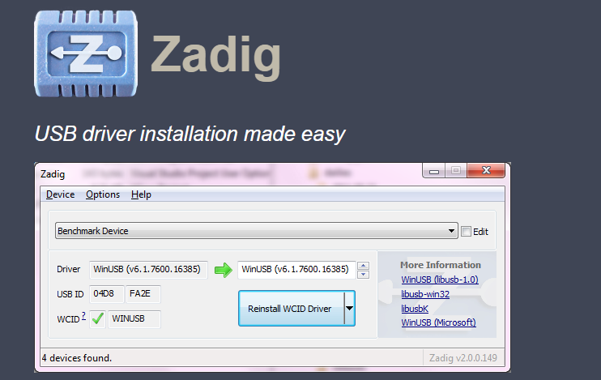
2. ページ内の Download 欄から最新版の **Zadig 2.x** をダウンロードする。  
   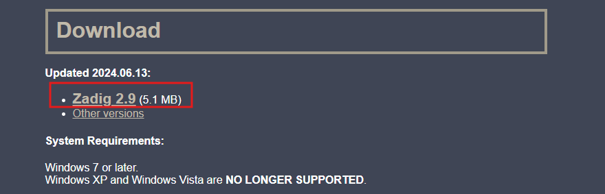
3. Pico W 本体の **BOOTSEL ボタン** を押したまま、USB ケーブルで PC と接続する。
4. PC に接続したら、**BOOTSEL ボタン** から指を離す。
5. ダウンロードした **zadig-2.x.exe** をダブルクリックする。  
   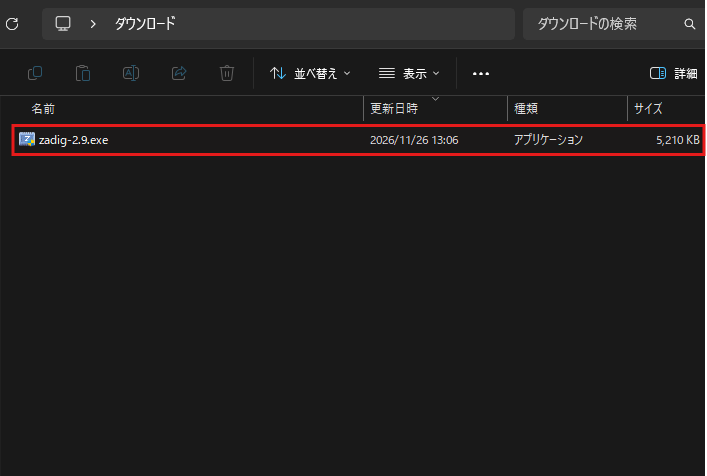
6. 「ユーザーアカウント制御」画面が表示されたら、管理者権限で実行する。
7. Zadig が起動したら、メニューバーの **Options** をクリックする。  
   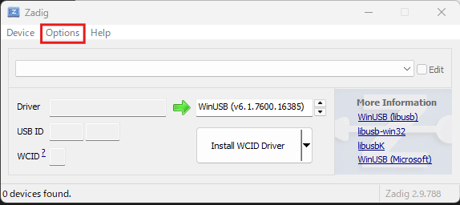
8. **List All Devices** をクリックしてチェックを入れる。  
   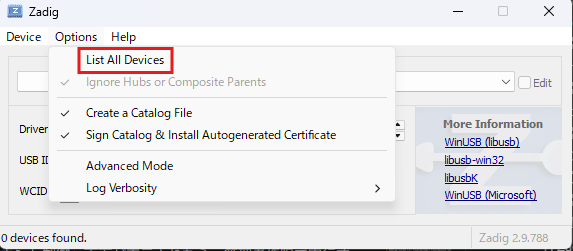
9. 上部のプルダウンメニューをクリックし、**RP2 Boot (Interface 1)** を選択する。  
   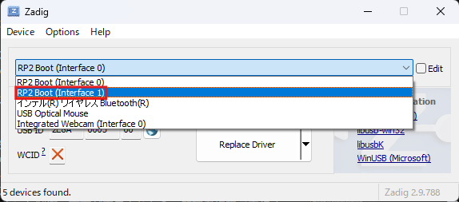
10. 矢印（`->`）の右側にあるドライバ選択欄の矢印をクリックし、**WinUSB (v6.1.xxxx.xxxxx)** を選択する。  
    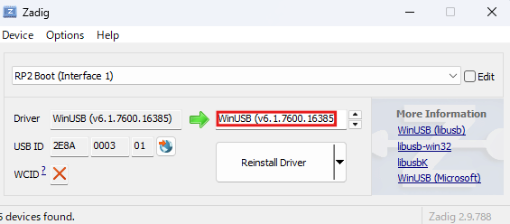
11. **Install Driver**（すでにドライバが入っている場合は **Reinstall Driver**）を押下する。  
    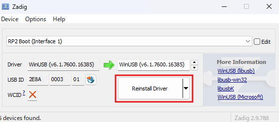

> 確認: 「The driver was installed successfully.」のダイアログが表示されれば成功。確認後、「×」ボタンを押下して Zadig を閉じ、PC から Pico W の USB ケーブルを一度抜くこと。  
> 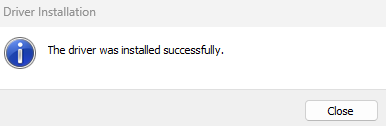

> 注意: プルダウンメニューでは必ず **RP2 Boot (Interface 1)** を選択すること。PC に接続されているマウスやキーボードなど、別の USB 機器のドライバを誤って書き換えないよう十分注意すること。

---

### 1.3 インストールできたことの確認

ここまでの手順で必要なツールと環境が正しくセットアップできているかを確認します。

1. Windows のスタートメニューから **Tera Term** を起動し、起動ダイアログが表示されることを確認する。確認後、「キャンセル」を押して閉じる。  
   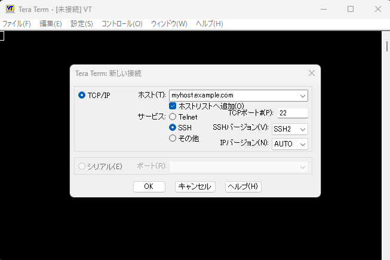
2. VS Code を開き、左側のアクティビティバーにある **Raspberry Pi のアイコン** をクリックする。
3. サイドバーに「New C/C++ Project」「Import Project」などのメニューが表示されることを確認する。  
<table>
  <tr>
    <td>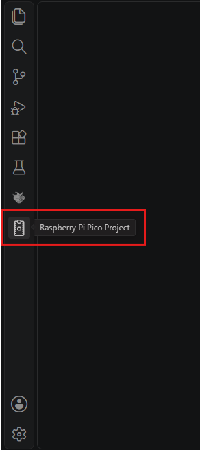</td>
    <td>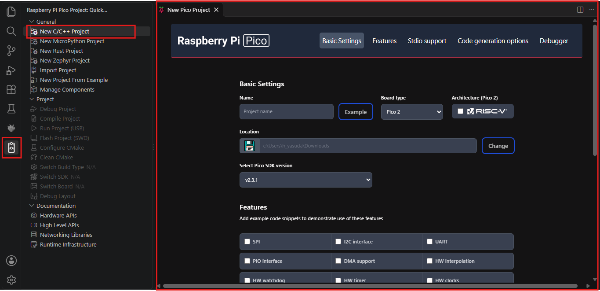</td>
  </tr>
</table>
> 確認: Tera Term が正常に起動し、VS Code の Raspberry Pi 拡張機能メニューが表示されていれば成功。

---

## 2. シリアルターミナルの使い方

### 2.1 使用するツールと接続方法
### 2.2 通信設定(ポート、ボーレートなど)
### 2.3 動作確認

## 3. プロジェクト作成

### 3.1 新規プロジェクトの作成
### 3.2 プロジェクトの構成(フォルダ・ファイルの役割)

## 4. コーディング・ビルド・書込み(RTOSなし)
<!-- 各題材の節は「作るもの → 配線 → プログラム → ビルドと書込み → 動作確認」の順で書く -->

### 4.1 題材1:LED点滅
### 4.1.1 題材1で作成するもの
題材1ではボード上にあるLEDを点滅させるプログラムを作成します
### 4.1.2 配線
配線は以下の図を参照

### 4.1.3 プログラム
題材1の動作に必要なファイルの詳細を記載する。  
以下の折りたたみの内容を該当するファイルに貼り付けること
<details>
<summary>[プロジェクト名].cの変更(クリックして詳細を表示)</summary>
[プロジェクト名].cppファイル内のコードを以下に変更する。

```cpp
#include <stdio.h>
#include "pico/stdlib.h"       // Pico SDKの基本機能を使用するためのヘッダ
#include "pico/cyw43_arch.h"   // CYW43チップ（オンボードLED）の制御用ヘッダ

int main(void)
{
    // CYW43チップを初期化する
    // 初期化に失敗した場合はプログラムを終了する
    if (cyw43_arch_init()) {
        return -1;
    }

    // LEDの点滅処理を繰り返す
    while (true) {

        // オンボードLEDを点灯させる（1：点灯）
        cyw43_arch_gpio_put(CYW43_WL_GPIO_LED_PIN, 1);

        // 500ミリ秒（0.5秒）待機する
        sleep_ms(500);

        // オンボードLEDを消灯させる（0：消灯）
        cyw43_arch_gpio_put(CYW43_WL_GPIO_LED_PIN, 0);

        // 500ミリ秒（0.5秒）待機する
        sleep_ms(500);
    }

    return 0;
}
```
</details>

<details>
<summary>CMakeLists.txt内の変更(クリックして詳細を表示)</summary> 
CMakeLists.txtは全て変更はせず、以下の項目のみ変更する

```
変更前
# Add the standard library to the build
target_link_libraries([プロジェクト名]
        pico_stdlib)
```

```
変更後
# Add the standard library to the build
target_link_libraries([プロジェクト名]
        pico_stdlib
        pico_cyw43_arch_none)
```

</details>

### 4.1.4 ビルドと書き込み
#### ビルド  
コーディング後、以下の手順でビルドを行う
1. vscodeの画面下部にある**compileボタン**を押下
2. ターミナルが表示されビルドが実行される
3. **ターミナルはタスクで再利用されます、閉じるには任意のキーを押してください。**と表示でビルド終了 
4. ターミナルの右枠にある**Compile Project**にチェックマークがついていていることを確認
5. buildフォルダに.uf2ファイルが存在することを確認
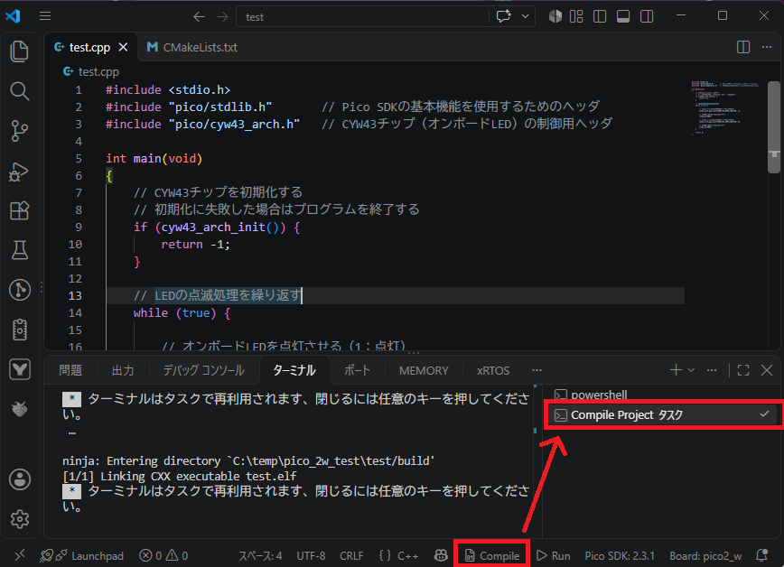

#### 書き込み  
ビルド完了後、ボードに.uf2ファイルを書き込む必要がある
書き込む手順は3種類あり、以下にその手順を記載する
- USB接続による書き込み（ドライブにコピー）
  1. ボードのbootselボタンを押しながらUSBでPCに接続する
  2. ドライブが認識されたら**bootselボタン**を離す
  3. buildフォルダにある.uf2ファイルをコピー
  4. 認識したドライブの直下にファイルをコピー
  5. コピー後、ドライブが切断される  
認識されるドライブと.uf2ファイルのコピーを下図に記載する
<br>
認識したドライブの直下にファイルをコピー
<br>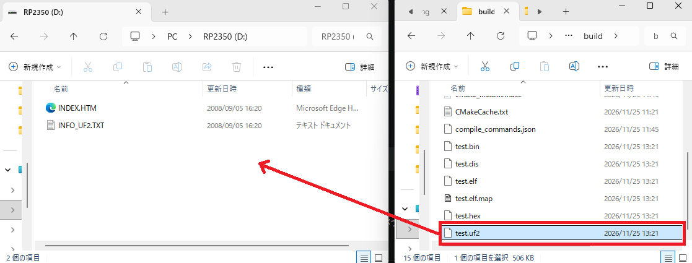
- picotoolによる書き込み（USB経由）
  1. ボードの**bootselボタン**を押しながらUSBでPCに接続する
  2. ドライブが認識されたら**bootselボタン**を離す
  3. vscodeの画面下部にある**runボタン**を押下
  4. ターミナルの右枠にある**Run Project**にチェックマークがついていていることを確認

- Debug Probeによる書き込み（SWD経由）
  1. Debug ProbeのD側をPicoのDEBUG端子に接続
  2. 接続したDebug ProbeをPCに接続
  3. picoとPCをUSBで接続
  4. VSCodeの左側にあるアクティビティバーから、**raspberry pi pico**を押下
  5. 表示されるメニューから**Flash Project (SWD)**を実行
  6. ターミナルの右枠にある**Flush**にチェックマークがついていていることを確認

上記のいずれかの方法で書き込みを行う

#### 動作確認
書き込みを実施後、ボードのLEDが0.5秒の間隔で点滅していることを確認する


### 4.2 題材2:ボタン入力
### 4.3 題材3:UART出力
### 4.4 題材4:タイマ割込み

## 5. コーディング・ビルド・書込み(FreeRTOS)

### 5.1 FreeRTOSの導入・設定
### 5.2 題材5:複数タスク
### 5.3 題材6:タスク間通信

## 6. デバッグ

### 6.1 デバッガの接続(配線図・写真)
### 6.2 デバッグの開始
### 6.3 ブレークポイント・ステップ実行
### 6.4 変数・メモリ・レジスタの確認

## 7. トラブルシューティング

| 症状 | 原因 | 対処 |
|---|---|---|
| | | |

## 8. 参考資料

- 

<!-- ボード独自の追加章がある場合は、ここから「## 9. 〜」として追加する -->
## 9. MicroPython

### 9.1 準備・開発環境構築
### 9.2 基本操作
### 9.3 題材1:LED点滅
### 9.4 題材2:ボタン入力
### 9.5 題材3:UART出力
### 9.6 題材4:タイマ割込み
###	9.7 デバッグ

<!--
  記述ルール(書きぶりを全章でそろえる)
  1. 見出し:章は「## 1. 開発環境構築」、節は「### 1.1 ツールのインストール」の形にする。
  2. 手順:番号付きリストで書き、1つの番号に1つの操作。文末は「〜する。」にそろえる。
  3. 確認:手順のあとに「> 確認:〜れば成功」と、成功したかどうかの判断方法を書く。
  4. 注意:まちがえやすい所は「> 注意:〜」と書く。
  5. 画像:画面操作にはスクリーンショットを付ける。images/ に置き、名前は担当番号から始める(例:p1_ext.png)。
  6. 図:処理の流れやタスクの関係は Mermaid で書く。配線は図か写真で、ピン番号と信号名を書く。
  7. プログラム:手順書の中にコードブロックで書き、日本語のコメントを付ける。
  8. バージョン:ツールと SDK のバージョンを書く。
  9. 用語:同じものは同じことばで書く。英数字は半角で、日本語との間に半角スペースを入れる。
  10. つまずいた点:第7章に必ず記録する。
-->
