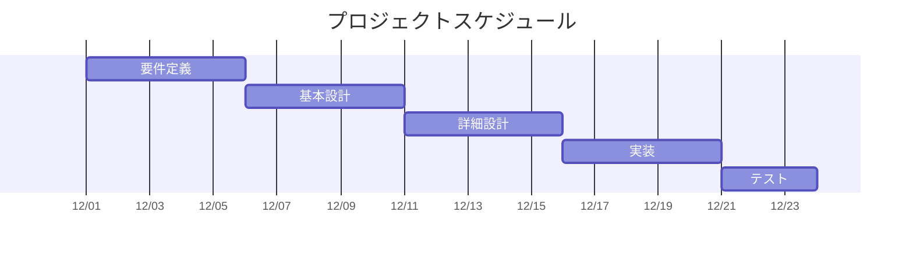

# ○○システム_要件定義書v.1.1
# 改訂履歴
| 改訂番号 | 改訂箇所             | 改訂内容     | 改訂日(作成日) | 改訂者(作成者) |
| -------- | -------------------- | ------------ | -------------- | -------------- |
| 初版     | -                    | -            | 2026/10/1      | ヒップ太郎     |
| v.1.1    | 5. 体制/スケジュール | メンバー追加 | 2026/10/5      | ヒップ太郎     |
|          |                      |              |                |                |

# 目次
- [1. はじめに](#1-はじめに)
- [2. システム概要](#2-システム概要)
    - [2.1. システム全体の構成](#21-システム全体の構成)
    - [2.2. 対象範囲](#22-対象範囲)
    - [2.3. 前提条件](#23-前提条件)
- [3. 機能要件一覧](#3-機能要件一覧)
- [4. 非機能要件一覧](#4-非機能要件一覧)
- [5. 体制/スケジュール](#5-体制スケジュール)
    - [5.1. プロジェクト体制](#51-プロジェクト体制)
    - [5.2. 期限](#52-期限)
    - [5.3. スケジュール](#53-スケジュール)

# 1. はじめに
本書は、〇〇システムの要件定義書である。 参考資料を以下に示す。

- ○○システム_要求書 v.1.1
- 超音波センサー仕様書
- マイコン仕様書(Raspberry Pi Pico 2 series)

# 2. システム概要

本システムは、閉じ込め防止用センサーの制御プログラムである。  
扉が閉じた状態でセンサーが人を検知すると、その状態をサーバーに通知する。  
また、検知している状態が続くと、ブザーとLEDにて周囲に警告を通知する。  

## 2.1. システム全体の構成
**○○システムの構成図を示す。**
  

  

## 2.2. 対象範囲
- ○○システム

## 2.3. 前提条件
<!--変更箇所-->
- LEDは○○を使用する。
- サーバーは構築済みのものを使用する。
- サーバーへの通知はHTTPで行う。
- サーバーのURL(エンドポイント)へJSON形式でPOSTする。
    - エンドポイント：　POST 192.168.80.190:9999
-  Wi-FiのSSIDは、”hip-sysiot”を使用する。
-  開発言語はC言語を使用する。
-  超音波センサーの測定できる距離は5 m以内であること。

# 3. 機能要件一覧
| 要件 | 内容 |
| ---- | ---- |
| センサー制御 | **センサーの距離○○ m以内** センサーONにする。 **リードSWがON状態**  センサーONにする。 **リードSWがOFF状態** センサーOFFにする。  Wi-Fiの接続有無に関わらず、 センサー状態はリアルタイムで更新する。  |
| ブザー出力 | **センサーＯＮ状態が5分続いた場合** ブザーを1回鳴らす。 **センサーON状態が10分以上続いた場合** OFF状態となるか一定時間経過するまでブザーを継続して鳴らす。 |
| LED出力 | **センサーＯＮ** LEDを点灯する。 **センサーＯFF** LEDを消灯する。 **Wi-Fi接続中** LEDを点滅する。  |
| 通信制御 | **Wi-Fi接続時** センサーの状態をサーバーへ通知する。 **Wi-Fi未接続時** 再接続を試みる。  |

# 4. 非機能要件一覧
<!--変更箇所-->
| 要件 | 内容 |
| ---- | ---- |
| サーバーとの通信間隔 | センサーの状態をサーバーへ１Sec間隔で通知する。 |
| ○○システムの品質 | 開発した○○システムは24時間365日稼働できること。 |
<!--| 超音波センサーの制約 | センサーの測定できる距離は5 m以内であること。 |-->

# 5. 体制/スケジュール

## 5.1. プロジェクト体制
| チームメンバー | 役割 |
| -------------- | ---- |
| ヒップ太郎 | リーダー担当 |
| ヒップ次郎 | メンバー |
| ヒップ三郎 | メンバー |
| メンバーD | メンバー |
| メンバーE | メンバー |
| メンバーF | メンバー |

## 5.2. 期限
<!--変更箇所-->
20xx年〇月〇日

## 5.3. スケジュール
<!--変更箇所-->
各プロセスの開始予定日・終了予定日・参加人数・工数見積もりを示す。

| プロセス | 開始予定日 | 終了予定日 | 人数 | 工数見積もり |
| -------- | ---------- | ---------- | ---- | ------------ |
| 要件定義 | 〇月〇日   | 〇月〇日   | 〇人 | 〇人日       |
| 基本設計 | 〇月〇日   | 〇月〇日   | 〇人 | 〇人日       |
| 詳細設計 | 〇月〇日   | 〇月〇日   | 〇人 | 〇人日       |
| 実装     | 〇月〇日   | 〇月〇日   | 〇人 | 〇人日       |
| テスト   | 〇月〇日   | 〇月〇日   | 〇人 | 〇人日       |

